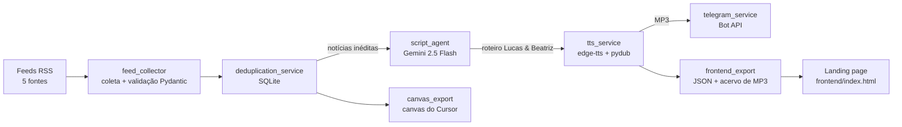

# 🎙️ Sintonia IA — Agente Autônomo de Podcast de Notícias de IA

[](https://github.com/ToniLima87/sintonia-ia/actions/workflows/ci.yml)
[](https://github.com/ToniLima87/sintonia-ia/actions/workflows/cd.yml)


Agente em Python que, todos os dias, **coleta notícias de Inteligência Artificial**, escreve com o **Gemini** um bate-papo em português do Brasil entre dois apresentadores, **transforma o roteiro em áudio** com vozes neurais, **envia o episódio para o Telegram** e **publica tudo numa landing page** com player e acervo de episódios.

Tudo roda sem intervenção humana: um agendador dispara o pipeline às 07:00 e o episódio chega no celular.

---

## ✨ Funcionalidades

- **Coleta via RSS** de 5 fontes de IA (OpenAI, Google DeepMind, Hugging Face, TechCrunch AI e arXiv cs.AI).
- **Deduplicação com SQLite**: notícias já usadas em episódios anteriores não se repetem.
- **Roteiro com LLM**: o Gemini traduz, seleciona e conecta as notícias em uma conversa natural entre **Lucas** (analista) e **Beatriz** (questionadora).
- **Síntese de voz** com `edge-tts` (`pt-BR-AntonioNeural` e `pt-BR-FranciscaNeural`), montada em um único MP3 com `pydub`.
- **Entrega no Telegram**: áudio do episódio + lista de notícias com links, via Bot API.
- **Landing page** com player real, acervo de episódios (um MP3 por dia), notícias traduzidas para pt-BR, roteiro completo e lista de feeds.
- **Agendamento diário** pelo Agendador de Tarefas do Windows ou por container Docker.
- **Tolerância a falhas**: se o Telegram ou a tradução falharem, o episódio continua sendo gerado; notícias só são marcadas como usadas depois que o áudio fica pronto.

---

## 🧭 Arquitetura



O orquestrador é o `main.py`, que executa as etapas em sequência:

1. Coleta até 5 notícias por feed.
2. Filtra as que já estão no banco `dados/noticias_historico.db`. Se não houver nada novo, encerra.
3. Gera o roteiro em pt-BR com o Gemini e salva em `dados/roteiro_hoje.txt`.
4. Sintetiza cada fala com a voz do apresentador e junta tudo em `podcast_ia_hoje.mp3`.
5. Registra as notícias como processadas.
6. Atualiza o canvas de links e fontes (quando roda no Cursor).
7. Exporta os dados da landing page, traduzindo títulos e resumos para pt-BR.
8. Envia o episódio para o Telegram.

---

## 🛠️ Tecnologias

| Camada | Ferramentas |
|---|---|
| Linguagem | Python 3.13 |
| Coleta e validação | `feedparser`, `pydantic` |
| IA generativa | `google-genai` (Gemini 2.5 Flash, saída estruturada em JSON) |
| Áudio | `edge-tts`, `pydub`, `ffmpeg` |
| Persistência | SQLite (`sqlite3` da biblioteca padrão) |
| Entrega | Telegram Bot API (`requests`) |
| Front-end | HTML, Tailwind CSS, JavaScript puro |
| Infra | Docker, Docker Compose, nginx, Agendador de Tarefas do Windows |

---

## 📁 Estrutura

```text
Agent_Noticias/
├── agent_noticias/
│   ├── feed_collector.py         # Feeds RSS e modelo NoticiasBrutas
│   ├── deduplication_service.py  # Histórico SQLite e filtragem de notícias repetidas
│   ├── script_agent.py           # Prompt dos apresentadores, roteiro e tradução com Gemini
│   ├── tts_service.py            # Vozes de Lucas e Beatriz e montagem do MP3
│   ├── telegram_service.py       # Envio do episódio e utilitários do bot
│   ├── frontend_export.py        # JSON e acervo de áudios para a landing page
│   └── canvas_export.py          # Canvas do Cursor com links e fontes
├── frontend/
│   ├── index.html                # Landing page
│   ├── data/episodio.json        # Episódio atual (gerado)
│   ├── data/episodios.json       # Acervo de episódios (gerado)
│   └── audio/AAAA-MM-DD.mp3      # Um áudio por dia (gerado)
├── dados/
│   ├── noticias_historico.db     # Histórico de notícias processadas
│   ├── roteiro_hoje.txt          # Último roteiro gerado
│   └── logs/agente.log           # Log das execuções agendadas no Windows
├── main.py                       # Orquestrador do pipeline
├── agendador.py                  # Agendador diário usado no Docker
├── ver_banco.py                  # Mostra o histórico do banco no terminal
├── tests/                        # Testes automatizados (pytest)
├── .github/workflows/            # Pipelines de CI e CD
├── Dockerfile
├── docker-compose.yml
├── pyproject.toml                # Configuração do ruff e do pytest
├── requirements-dev.txt          # Dependências de desenvolvimento
├── rodar_agente.bat              # Executado pelo Agendador de Tarefas do Windows
├── servir_frontend.bat           # Abre a landing page localmente
├── requirements.txt
└── .env.example
```

---

## ⚙️ Configuração

### 1. Chaves de acesso

Copie o modelo e preencha o `.env` (ele está no `.gitignore` e nunca deve ser versionado):

```bash
cp .env.example .env
```

| Variável | Obrigatória | Onde obter |
|---|---|---|
| `GEMINI_API_KEY` | Sim | [Google AI Studio](https://aistudio.google.com/apikey) |
| `TELEGRAM_BOT_TOKEN` | Para envio no Telegram | Crie um bot com o [@BotFather](https://t.me/BotFather) (`/newbot`) |
| `TELEGRAM_CHAT_ID` | Para envio no Telegram | Veja o passo abaixo |
| `HORARIO_EXECUCAO` | Não (padrão `07:00`) | Horário do episódio diário no Docker |
| `RODAR_AO_INICIAR` | Não (padrão `false`) | Gera um episódio assim que o container sobe |

**Descobrindo o `TELEGRAM_CHAT_ID`:** abra o seu bot no Telegram, toque em **Iniciar** e mande qualquer mensagem. Depois rode:

```bash
python -m agent_noticias.telegram_service chat-id
```

Sem as variáveis do Telegram, o pipeline funciona normalmente e apenas pula o envio.

### 2. Rodando localmente

Pré-requisitos: Python 3.13 e [ffmpeg](https://ffmpeg.org/download.html) no `PATH`.

```bash
python -m venv .venv
```

Os comandos abaixo usam o Python do `.venv`. No Windows, troque pelo caminho correspondente ao seu terminal:

| Terminal | Python do ambiente virtual |
|---|---|
| PowerShell | `& ".\.venv\Scripts\python.exe"` |
| Git Bash / WSL apontando para o venv do Windows | `./.venv/Scripts/python.exe` |
| Linux / macOS | `./.venv/bin/python` |

```bash
python -m pip install -r requirements.txt
python -X utf8 main.py
```

Em cerca de 2 minutos o episódio é gerado e enviado. Resultado esperado:

```text
🚀 === INICIANDO AGENTE AUTÔNOMO DE PODCAST DE IA ===
Total de notícias coletadas: 25
🧹 Filtragem de duplicadas: 20 de 25 são inéditas.
Podcast salvo com sucesso em: .../podcast_ia_hoje.mp3
Landing page atualizada: episódio #2 (2 no acervo).
📨 Episódio enviado ao Telegram.
✅ Pipeline autônomo concluído!
```

---

## 🐳 Docker

O `docker-compose.yml` sobe dois serviços:

- **`agente`**: roda o `agendador.py`, que executa o pipeline todos os dias às 07:00 (fuso `America/Sao_Paulo`). As pastas `dados/` e `frontend/` ficam em volumes, então o histórico sobrevive à recriação do container.
- **`landing-page`**: nginx servindo a landing page em [http://localhost:8080](http://localhost:8080).

Rode **um comando por vez**, conforme o que você quer fazer:

| Objetivo | Comando |
|---|---|
| Subir agente + landing page | `docker compose up -d --build` |
| Acompanhar o agente (`Ctrl+C` para sair) | `docker compose logs -f agente` |
| Gerar um episódio agora | `docker compose run --rm agente python main.py` |
| Desligar tudo (o agendamento diário para) | `docker compose down` |

> Use **um** agendador por vez: o container ou a tarefa do Windows. Com os dois ativos, o episódio é enviado duas vezes.

> **Windows + WSL:** suba os containers pelo **PowerShell** (caminho `C:\...`), não pelo terminal WSL (`/mnt/c/...`). Quando o Docker Desktop reinicia os containers ao ligar o PC, pastas montadas a partir de `/mnt/c` podem aparecer vazias: a landing page responde `403 Forbidden` e o agente perde o acesso ao histórico. O Docker Desktop precisa estar aberto antes de qualquer comando `docker`.

---

## ✅ Testes e CI/CD

Os testes cobrem coleta, deduplicação, roteiro, tradução, síntese de voz, Telegram, landing page e agendador. Rodam sem internet e sem chaves: feeds, Gemini, edge-tts e Telegram são substituídos por versões falsas.

```bash
python -m pip install -r requirements-dev.txt
ruff check .        # lint
pytest -v           # testes
```

Pipelines no GitHub Actions (`.github/workflows/`):

| Workflow | Quando roda | O que faz |
|---|---|---|
| **CI** (`ci.yml`) | Todo push na `main` e todo pull request | Lint com ruff, testes com pytest, build da imagem Docker e validação do `docker-compose.yml` |
| **CD** (`cd.yml`) | Quando o CI passa na `main` | Publica a imagem em `ghcr.io/tonilima87/sintonia-ia` com as tags `latest` e o hash do commit |

Para rodar a imagem publicada em qualquer servidor com Docker:

```bash
docker pull ghcr.io/tonilima87/sintonia-ia:latest
```

---

## ⏰ Agendamento no Windows (sem Docker)

O `rodar_agente.bat` executa o pipeline e grava a saída em `dados/logs/agente.log`. Para agendar às 07:00 todos os dias (PowerShell):

```powershell
schtasks /Create /TN "Agent_Noticias" /TR "\"$PWD\rodar_agente.bat\"" /SC DAILY /ST 07:00
```

A tarefa roda com o usuário logado. Se o computador estiver desligado no horário, ela é executada assim que ele for ligado.

---

## 🌐 Landing page

A página em `frontend/index.html` lê os arquivos gerados pelo agente:

- `data/episodio.json` — episódio atual: áudio, duração, notícias (título e resumo em pt-BR, com o original preservado), falas do roteiro, feeds e modelo usado.
- `data/episodios.json` — acervo com todos os episódios, um por dia.

Ela precisa ser aberta por um servidor HTTP (o navegador bloqueia a leitura dos JSON em `file://`):

```bash
python -m http.server 8000 --directory frontend   # http://localhost:8000
```

Para regenerar os dados da página sem criar um episódio novo:

```bash
python -m agent_noticias.frontend_export
```

---

## 🧰 Comandos úteis

| Comando | O que faz |
|---|---|
| `python main.py` | Executa o pipeline completo |
| `python ver_banco.py` | Lista as notícias já processadas, agrupadas por dia |
| `python -m agent_noticias.telegram_service enviar` | Reenvia o último episódio ao Telegram |
| `python -m agent_noticias.telegram_service chat-id` | Mostra os chats que falaram com o bot |
| `python -m agent_noticias.frontend_export` | Atualiza os dados da landing page |
| `python -m agent_noticias.script_agent` | Gera só o roteiro, sem áudio |

---

## 🩺 Problemas comuns

| Mensagem | Causa e solução |
|---|---|
| `Nenhuma notícia nova encontrada hoje` | Não é erro: os feeds ainda não publicaram nada inédito. Tente mais tarde. |
| `402 RESOURCE_EXHAUSTED` | Créditos da API do Gemini esgotados. Recarregue no Google AI Studio; as notícias pendentes entram no próximo episódio. |
| `UnicodeEncodeError` no Windows | Rode com `python -X utf8 ...`. |
| `syntax error near unexpected token '&'` | Comando do PowerShell colado no bash. Use `./.venv/Scripts/python.exe`. |
| Telegram `Not Found` / `Unauthorized` | Token inválido no `.env`. Gere outro no @BotFather. |
| Landing page vazia | A página foi aberta via `file://`. Use um servidor HTTP (veja acima). |

---

## 🔐 Segurança

- Chaves ficam apenas no `.env`, ignorado pelo Git e pelo Docker (`.gitignore` e `.dockerignore`).
- No Docker, o `.env` é injetado em tempo de execução e não entra na imagem.
- Mensagens de erro do Telegram nunca exibem o token do bot.
